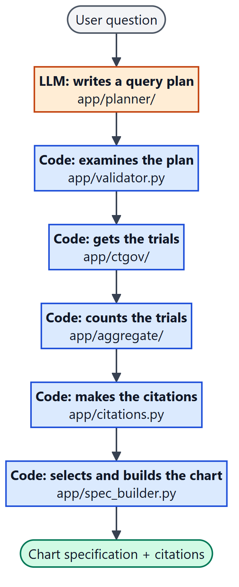
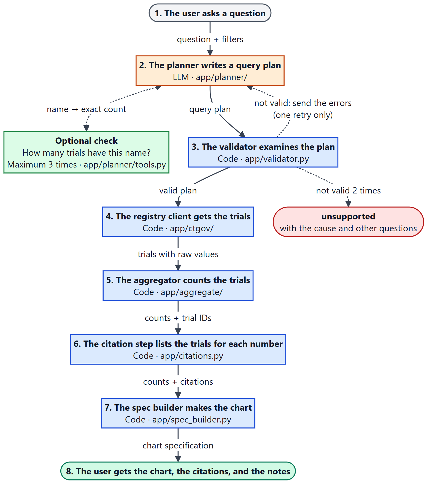
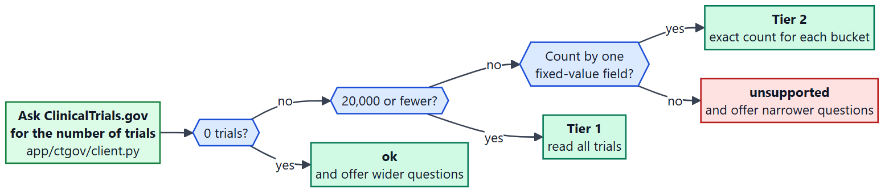
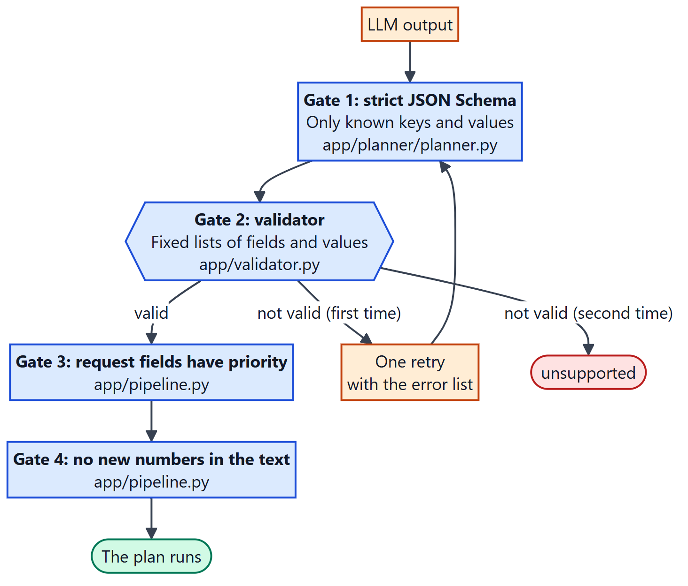
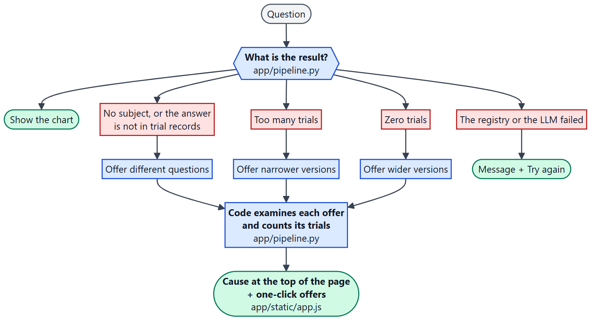
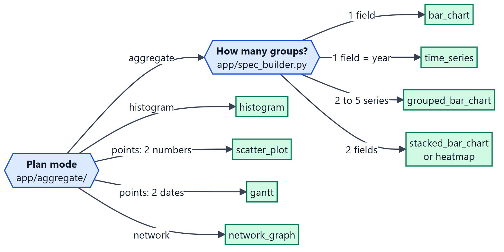
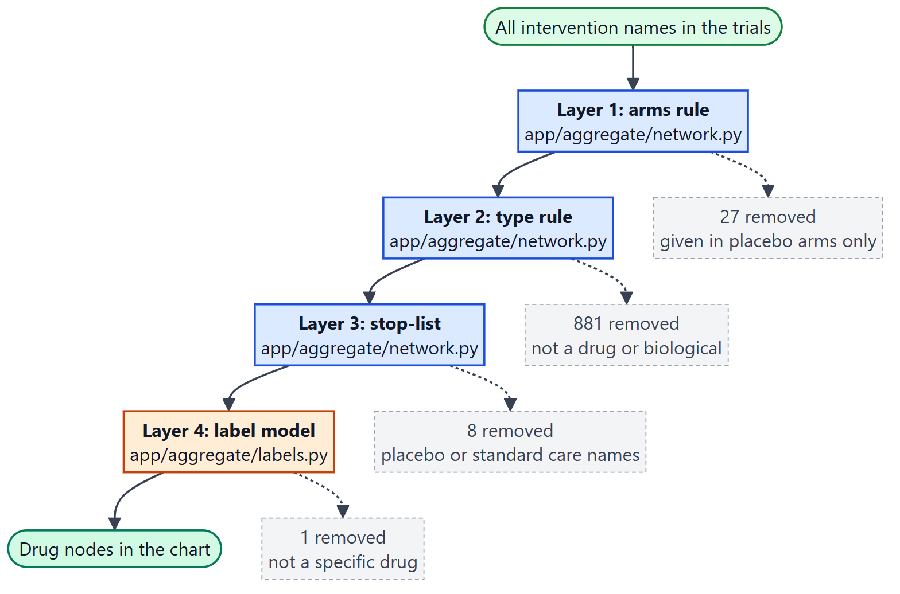
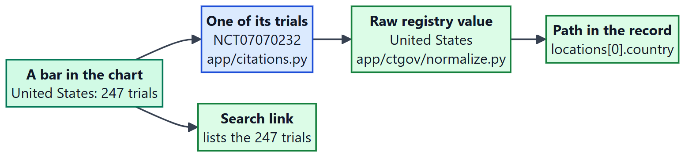

# ClinicalTrials.gov Query-to-Visualization Agent

This service changes a question about clinical trials into a **chart specification**.
The data comes from the live [ClinicalTrials.gov](https://clinicaltrials.gov) API.
Each number in the chart has citations to the trial records.

> Question: "Which countries have the most recruiting trials for melanoma?"
> Answer: a `bar_chart` specification with ten bars. Each bar has an exact trial count, a list of
> trials, the registry value that put each trial in the bar, and a search link.

In this document, "the registry" means ClinicalTrials.gov.

**The main design rule:** the language model (LLM) writes a small **query plan** and does nothing
else. Code does all other work. No number, title, trial ID, or citation comes from the LLM.

**Diagram 1. Who does what**

Files: `app/planner/`, `app/validator.py`, `app/ctgov/`, `app/aggregate/`, `app/citations.py`, `app/spec_builder.py`



*How to read it: Read from top to bottom. The LLM does one step (orange). Code does all other steps (blue).*

## How this README agrees with the evaluation criteria

| Weight | Criterion | Section |
|---|---|---|
| 35% | System Design | [4](#4-system-design-35). The design decisions and tradeoffs are in [4.6](#46-key-design-decisions-and-tradeoffs). |
| 20% | AI / Agent Design | [5](#5-ai--agent-design-20) |
| 20% | Code Quality | [6](#6-code-quality-20) |
| 15% | Query and Visualization Coverage | [7](#7-query-and-visualization-coverage-15) |
| 10% | Input/Output Design | [2](#2-request-schema-inputoutput-design-10) and [3](#3-response-schema-inputoutput-design-10) |
| Bonus | Deep citations | [8](#8-bonus-deep-citations) |

Other mandatory items: how to run ([1](#1-how-to-run)), example runs ([9](#9-example-runs)),
limitations ([10](#10-limitations-and-improvements)), demo ([11](#11-demo-page-optional)),
integrity note ([12](#12-integrity-note-ai-tools)).

**More detail is in separate files.** The README gives the main points only.

| File | Content |
|---|---|
| [docs/DESIGN.md](docs/DESIGN.md) | Rate limit, cache, names, network layers, tradeoffs |
| [docs/EVALUATION.md](docs/EVALUATION.md) | Planner evaluation, tests, failure table, live checks |
| [docs/RESPONSE_DETAILS.md](docs/RESPONSE_DETAILS.md) | Trace steps, error codes, suggestions |
| [docs/CONFIGURATION.md](docs/CONFIGURATION.md) | All settings, test commands, the run log |
| [docs/DEMO.md](docs/DEMO.md) | The demo page and the browser tests |
| [docs/diagrams/index.html](docs/diagrams/index.html) | All diagrams on one page |

**Colors in the diagrams:** orange = an LLM step. Blue = a code step. Green = registry data or a
good result. Red = a refusal or a failure. Gray = the user, or a removed item.

---

## 1. How to run

You must have [uv](https://docs.astral.sh/uv/) and an OpenAI API key. uv installs Python 3.12.

```bash
uv sync                                   # 1. Install.
cp .env.example .env                      # 2. Configure. Put your key in OPENAI_API_KEY.
                                          #    Skip this step if the folder already has a .env file.
uv run uvicorn app.api:app --reload       # 3. Start. The address is http://127.0.0.1:8000
```

Then do one of these steps:

- Open **http://127.0.0.1:8000** to use the demo page.
- Send a request to the API:

```bash
curl -s http://127.0.0.1:8000/query -H "Content-Type: application/json" \
  -d '{"query": "How are psoriasis trials distributed across phases?", "max_citations": 3}'
```

| Endpoint | Function |
|---|---|
| `POST /query` | Answers one question. |
| `GET /schema` | Gives the JSON Schema of the request and the response. The code generates it. |
| `GET /health` | Shows that the service is in operation. |
| `GET /` | Shows the demo page. |

To run the tests: `uv run pytest -q` (804 tests, no network and no key are necessary).
All settings and tools are in [docs/CONFIGURATION.md](docs/CONFIGURATION.md).

---

## 2. Request schema (Input/Output Design, 10%)

> **Evidence for this criterion**
> - One request type and one response type for all results. `GET /schema` gives the JSON Schema.
> - `visualization.type` sets the structure of `encoding` and `data`. A frontend does not guess.
> - The demo page uses only the documented response and draws all 9 chart types.

Send `POST /query` with a JSON body. Only `query` is mandatory.
The service refuses fields that are not in this table (HTTP 422).

| Field | Type | Mandatory | Validation and meaning |
|---|---|---|---|
| `query` | string | yes | 3 to 500 characters. The question in natural language. |
| `drug_name` | string or list of strings | no | Maximum 5 names. One name is a filter. Two or more names make one comparison series each. |
| `condition` | string or list of strings | no | Maximum 5 names. The rule is the same as for `drug_name`. |
| `sponsor` | string | no | Not empty. A filter on the sponsor name. |
| `trial_phase` | list of enum | no | `EARLY_PHASE1`, `PHASE1`, `PHASE2`, `PHASE3`, `PHASE4`, `NA`. |
| `status` | list of enum | no | Registry status values, for example `RECRUITING`, `COMPLETED`. The full list is in `/schema`. |
| `country` | string | no | Not empty. Trials with a site in this country. |
| `start_year`, `end_year` | integer | no | 1990 to the current year + 5. `start_year` must not be larger than `end_year`. |
| `chart_type` | enum | no | The chart that the user prefers. The service uses it when it fits the data. |
| `max_citations` | integer | no | 0 to 50. Default 10. The maximum number of trials listed for each data point. |
| `debug` | boolean | no | Default `true`. Adds the step trace in `meta.trace`. |

- **A request field has priority over the question text.** If they disagree, the service uses
  the field and writes a note in `meta.notes`.
- The service refuses a request with a list of drugs and a list of conditions together.

```json
{ "query": "Which countries have the most trials?", "condition": "cystic fibrosis", "status": ["RECRUITING"] }
```

---

## 3. Response schema (Input/Output Design, 10%)

All responses have the same structure. A frontend reads `status` first.

| HTTP status | `status` | Meaning |
|---|---|---|
| 200 | `ok` | The response contains a chart. |
| 200 | `unsupported` | The service cannot make a chart for this question. `error` gives the cause and other questions to try. |
| 503 | `error` | The registry or the LLM failed. A second try can be successful. |
| 422 | none | The request is not valid. |

```jsonc
{
  "status": "ok",                 // ok | unsupported | error
  "query": "…",                   // the question as sent
  "visualization": { "type": "…", "title": "…", "encoding": { … }, "data": [ … ] },   // null if not ok
  "citations": { "d1": { … } },   // datum id -> the trials that the datum counts
  "meta": { … },                  // how to read the chart, and what the service did
  "error": null                   // { code, message, details[], suggestions[] } if not ok
}
```

### 3.1 `visualization`

- Each encoding channel is `{ "field", "type", "title", "unit" }`. `field` is the key to read in each data row.
- `type` is `categorical`, `quantitative`, or `temporal`.
- Each data row has an `id`. The `id` is the key in `citations`.

| `type` | `encoding` | One row of `data` |
|---|---|---|
| `bar_chart` | `x`, `y` | `{id, <x>, trial_count}` |
| `grouped_bar_chart` | `x`, `y`, `series` | `{id, <x>, series, trial_count}` |
| `stacked_bar_chart` | `x`, `y`, `stack` | `{id, <x>, <stack>, trial_count}` |
| `heatmap` | `x`, `y`, `color` | `{id, <x>, <y>, trial_count}` |
| `time_series` | `x` (year), `y`, optional `series` | `{id, year, series?, trial_count}` |
| `histogram` | `x` (bin), `y` | `{id, bin_start, bin_end, trial_count, is_overflow}` |
| `scatter_plot` | `x`, `y`, optional `series` | `{id, nct_id, <x>, <y>, series?}` |
| `gantt` | `y` (label), `start`, `end` | `{id, nct_id, label, start, end}` |
| `network_graph` | `nodes: {label, size, color}`, `edges: {source, target, weight}` | `data = {nodes: [{id, label, type, trial_count}], edges: [{id, source, target, shared_trials}]}` |

Rules for a renderer:

- `<x>`, `<y>`, and `<stack>` are field names such as `phase` or `country`. Read the name from `encoding`.
- Each grid is complete. The count is `0` when there are no trials.
- A histogram bin is `[bin_start, bin_end)`. A last row with `is_overflow: true` contains all larger values.
- Category values are display labels, for example `"Phase 1/2"`. They are not registry codes.
- Trials with no value are in a bucket with the label `"Unknown"`.

### 3.2 `citations`

There is one entry for each datum `id`. See [section 8](#8-bonus-deep-citations) for the full example.

`{ total, shown, is_sample, search_url, search_is_exact, items: [{ nct_id, title, url, bucket_label, evidence: [{ field, value }] }] }`

### 3.3 `meta`

| Key | Meaning |
|---|---|
| `plan` | The validated query plan: mode, filters, series, and `group_by`. |
| `interpretation` | One sentence that tells what the service counted or plotted. |
| `filters_applied` | Series label → the filters sent to the registry. |
| `search_terms` | Search terms that are different from the typed text, for example a corrected spelling. |
| `sort`, `time_granularity`, `units` | How to sort and label the chart. |
| `trials_matched`, `trials_used` | Trials that agree with the filters. Trials that are in the chart. |
| `tier` | `1`: the service read all trials. `2`: exact counts from the registry plus sample trials. |
| `chart_overridden` | `true` when the service replaced the requested chart type. A note gives the cause. |
| `notes` | A plain-language list of each assumption, removal, merge, and replacement. |
| `suggestions` | When no trials agree with the filters: other questions that find trials. |
| `source`, `data_timestamp`, `retrieved_at` | Always `clinicaltrials.gov`. The last registry data refresh. The time of this run. |
| `trace` | The steps of the run. `null` when `debug` is false. |

The trace steps, the error codes, and the suggestion rules are in
[docs/RESPONSE_DETAILS.md](docs/RESPONSE_DETAILS.md).

---

## 4. System Design (35%)

> **Evidence for this criterion**
> - **Clear decisions:** seven design principles, each with its effect in the code (4.1).
> - **Extensibility:** to add a field, a plan mode, a chart type, or a tool is one entry (4.3).
> - **Real API data:** page limit, rate limit, large results, cache, and dirty names (4.5).
> - **Tradeoffs:** 19 decisions, each with its reason and its cost (4.6).

### 4.1 Seven design principles

| | Principle | Effect in this system |
|---|---|---|
| P1 | **The LLM plans. Code computes.** | The only LLM output is a `QueryPlan`. The LLM does not fetch, count, write titles, or cite. |
| P2 | **Validate each plan before it runs.** | Field names, enums, and limits come from fixed lists. A plan that is not valid gets one retry. |
| P3 | **Structured fields first, rules second, LLM last.** | Used to remove placebos from networks. |
| P4 | **Do not add a filter that the user did not ask for.** | No default status or date range. Each assumption is written in `meta.notes`. |
| P5 | **Parts that combine. No special-case handlers.** | A question is filters × series × group_by × mode. No code branch reads a word of the question. |
| P6 | **An honest failure is better than a wrong chart.** | The service uses a full series or no series. It does not count from an incomplete read. |
| P7 | **No agent framework.** | The flow is fixed. The code uses the OpenAI SDK, a short tool loop, and a typed `RunState`. |

### 4.2 Structure of the code

Each file has one task. The data moves in one direction. Each file starts with a short map:
`TASK`, `GRADING`, `INPUT`, `OUTPUT`, `USED BY`, `DIAGRAM`, and `PARTS`.

**Diagram 2. The life of one request**

Files: `app/pipeline.py` (runs the steps), `app/planner/`, `app/validator.py`, `app/ctgov/`, `app/aggregate/`, `app/citations.py`, `app/spec_builder.py`



*How to read it: Read the numbers 1 to 8 from top to bottom. The text on each arrow is the data that goes to the next step. A dotted arrow is a check or a retry.*

| File | Task |
|---|---|
| `app/api.py` | HTTP endpoints. |
| `app/models.py` | All data types that files share: request, plan, trial, response. |
| `app/registry.py` | The field registry: one entry for each field of a trial. |
| `app/planner/` | The LLM step: prompt, tools, and the tool loop. |
| `app/validator.py` | The rules that each plan must obey. |
| `app/ctgov/` | All calls to the registry, and the change from a raw record to a `Trial`. |
| `app/aggregate/` | One aggregator for each plan mode. Changes trials into data points. |
| `app/citations.py` | Makes the citations for each data point. |
| `app/spec_builder.py` | Selects the chart type. Makes the encoding, the title, and the response. |
| `app/pipeline.py` | Connects the files. Holds the `RunState` for one request. |

### 4.3 How to extend the system

| To add | Do this |
|---|---|
| A field | Add one entry in `app/registry.py` and one attribute on `Trial`. |
| A plan mode | Add one aggregator function and one entry in the `AGGREGATORS` table in `app/pipeline.py`. |
| A chart type | Add one encoding type in `app/models.py` and one rule in `app/spec_builder.py`. |
| A planner tool | Add one function in `app/planner/tools.py`. |

The **field registry** makes this possible. One entry holds all facts about a field: its path,
its kind, its filter, its labels, and its order. The validator, the prompt, the client,
normalization, and citations all read it. Thus a field is defined in one place only.

### 4.4 The plan: `series` and `group_by`

The plan is the only interface between language and code.

```jsonc
{ "mode": "aggregate",                               // aggregate | histogram | points | network
  "filters": { "condition": "melanoma", "status": ["RECRUITING"] },   // for all series
  "series": [ { "label": "All", "filters": {} } ],   // groups that THE USER names, to compare
  "group_by": ["country"],                           // buckets that COME FROM THE DATA
  "sort": "desc", "limit": 10, … }
```

- The service fetches each `series` with a separate search.
- The service computes the `group_by` buckets from the fetched trials.
- Thus one mechanism answers "drug A compared with drug B by phase" (two series) and
  "trials by phase and sponsor category" (two `group_by`).

### 4.5 Sensible handling of real API data

**Diagram 4. How many trials can the service read?**

Files: `app/ctgov/client.py`, `app/pipeline.py`



*How to read it: Start on the left. Answer each question with yes or no. Green is an answer. Red is a refusal with offers.*

| Problem in the real API | Decision |
|---|---|
| A page has a maximum of 1,000 trials, and the API does not report this limit. | The client always follows `nextPageToken`. |
| A question can find more than 100,000 trials. | Up to 20,000: read all. More: ask for exact bucket counts, or refuse with narrower questions. |
| The API has a rate limit that is not documented (measured: request 11 in 10 s gets HTTP 429). | A sliding window of 8 requests in 10 s. After HTTP 429, all requests wait. |
| To read trials is slow (1,000 trials each second). | The client keeps each page in memory until the registry publishes new data. One read answers different questions. |
| A trial has two or more countries or drugs. | The trial counts one time for each value, and a note tells the user. |
| One name has different spellings. | Spellings that are different only in capital letters or hyphens become one bar. |
| The registry gives a placebo the type `DRUG`. | Four removal layers. See [7](#7-query-and-visualization-coverage-15). |
| A study record cannot be read. | The fetch fails. To skip the record would change the counts. |

### 4.6 Key design decisions and tradeoffs

Each decision below was made on purpose. The table gives the reason and the cost.

| # | Decision | Reason | Tradeoff |
|---|---|---|---|
| 1 | **The LLM writes a query plan only.** Code does all other work. | An LLM can invent numbers, trial IDs, and titles. Code cannot. | The system answers only the questions that a plan can express. |
| 2 | **The plan has `series` and `group_by` as separate parts.** | `series` are groups that the user names. `group_by` buckets come from the data. One mechanism then answers comparisons and breakdowns. | The LLM must learn the difference. Code corrects one common error (a single series). |
| 3 | **One field registry holds all facts about each field.** | The validator, the prompt, the client, and citations read the same list. To add a field is one entry. | A field that is not in the list cannot be used. There are 17 fields. |
| 4 | **Validate each plan, with one retry only.** | The LLM can correct an error when it gets the exact problem. More retries add time and cost. | A plan that fails two times gives `unsupported`. |
| 5 | **Explicit request fields have priority over the question text.** | A filter that the user sets in a field is certain. Text that the LLM reads is not. | The response must tell the user about each conflict. A note does this. |
| 6 | **Do not add a filter that the user did not ask for.** | A hidden default filter gives a number that the user does not expect. | Some questions find very many trials. See decision 7. |
| 7 | **Two tiers for the size of the result, with a limit of 20,000 trials.** | Up to 20,000 trials, all charts are possible. Above that, the registry gives exact counts for fixed-value fields. | Above 20,000 trials, some questions get a refusal with narrower questions. |
| 8 | **Use a full series or no series.** The service does not count from an incomplete read. | A count from half of the trials looks correct but is wrong. | One failed page makes the full series fail. |
| 9 | **A sliding-window rate limiter: 8 requests in 10 seconds.** | Measured on the live API: request 11 in 10 seconds gets HTTP 429, and then a block of 8 to 16 seconds. | A large first question takes 20 to 30 seconds. |
| 10 | **Fetch all fields, and keep the pages in memory until the registry has new data.** | One read of a subject then answers different questions in 5 to 8 seconds. | More memory. The cache is empty after a restart. |
| 11 | **Count a trial one time for each value of a list field** (country, drug). **Join the phases into one label** ("Phase 1/2"). | A trial in five countries is a trial in each of them. A Phase 1/2 trial is one thing, not two. | Bars can add up to more than the number of trials. A note tells the user. |
| 12 | **Merge spellings, but not synonyms.** | "Non-small Cell" and "Non Small Cell" are the same name. The service cannot make sure that "MTX" is methotrexate. | Synonyms stay as separate bars. |
| 13 | **Four layers to remove items that are not drugs from a network. The LLM is the last layer.** | The registry gives a placebo the type `DRUG`. Rules are more reliable than an LLM, so they run first. In the example, the rules removed 916 names and the LLM removed 1. | The arm rule sometimes removes an active control (3 of 114 in a check). |
| 14 | **Show only the 60 strongest connections of a network.** | A graph with 1,600 lines has no meaning. | The graph is not complete. The response tells the limit. |
| 15 | **Code selects the chart type and writes the title, after it counts.** | The best chart depends on the data. A title made from the filters cannot be wrong. | The LLM chart suggestion is only a suggestion. Titles are plain. |
| 16 | **Citations keep the raw registry value and its path.** | A reader can examine each number against the trial record. | Each trial carries more data in memory. |
| 17 | **Examine each suggested question before it is offered.** | An offered question that fails is worse than no offer. | A refusal takes 6 to 12 seconds, not 3 seconds. |
| 18 | **No database and no agent framework.** | The registry is the authority and changes each day. The flow is fixed, so a framework adds layers but no function. | The first question about a subject is always slow. |
| 19 | **Store nothing at the LLM provider** (`store=False`). | Privacy. It also works with Zero Data Retention accounts. | Each LLM call sends the full conversation. |

The measurements for these decisions are in [docs/DESIGN.md](docs/DESIGN.md).

---

## 5. AI / Agent Design (20%)

> **Evidence for this criterion**
> - **No invented data:** the LLM writes a plan only. Code computes each number and citation.
> - **Validation:** a strict JSON Schema, then a validator, then one retry.
> - **Tools:** two read-only tools, with a maximum of 3 calls.

**Diagram 5. The gates that the LLM output must pass**

Files: `app/planner/planner.py`, `app/validator.py`, `app/pipeline.py`



*How to read it: Read from top to bottom. The plan runs only after it passes all four gates.*

### 5.1 Each risk and its control

| Risk | Control |
|---|---|
| The LLM invents a number, a trial ID, or a citation. | The LLM does not write them. Code computes them from fetched trials. |
| The LLM invents a field name or an enum value. | The output has a strict JSON schema. The validator examines each name against the field registry. |
| The LLM writes a plan that is not valid. | The validator sends the error list to the LLM for one retry. After that, the response is `unsupported`. |
| The LLM writes a wrong number in its one free-text sentence. | Code replaces the sentence if it contains a number or a trial ID that the LLM did not get. |
| The LLM adds a filter that the user did not ask for. | The prompt forbids it. The evaluation fails a plan with an extra filter. |
| The LLM calls tools without end. | The loop stops after 3 tool calls. |
| The question contains instructions for the LLM. | The LLM can only output a plan. The plan must pass validation. |
| The label model invents a name. | Code refuses each returned name that it did not send. |
| The LLM offers a question that the system cannot answer. | Code plans, validates, and counts each offered question before it shows it. |

### 5.2 Tools

| Tool | Function | Reason |
|---|---|---|
| `count_trials(filters)` | Gives the exact number of trials for a set of filters. | The planner can make sure that a name finds trials, for example a misspelled drug. |
| `list_fields()` | Gives the fields and their values. | The planner can make sure that a field exists. |

The tools only read. Examples from live runs: "pembrolizumub" → "pembrolizumab" (2,974 trials).
"J&J" (661 trials) → "Johnson & Johnson" (1,549 trials).

### 5.3 Evaluation of the planner

29 questions: 9 from the assignment appendix, 8 others, 3 that must be refused, 9 with difficult words.

| Model | Passed | Median time | Estimated cost for each question |
|---|---|---|---|
| `gpt-5.4-nano` | 29/29 | 2.6 s | $0.0015 |
| `gpt-5.4-mini` (default) | 29/29, then 28/29 on a second run | 2.3 s | $0.0055 |
| `gpt-5.4` | 29/29 | 3.7 s | $0.0165 |

The set does not show a difference between the models. A score of 100% does not mean that
planning has no errors. A second run of the default model failed one question: "Map which
sponsors run sickle cell disease trials in which countries". In 7 runs of that question, the
planner gave a network 5 times and a two-field count 2 times. The two plans are valid, but the
test expects a network. Details are in [docs/EVALUATION.md](docs/EVALUATION.md).

---

## 6. Code Quality (20%)

> **Evidence for this criterion**
> - **Organization:** each file has one task, and starts with a `TASK` line and a `GRADING` line.
> - **Correctness:** 804 automated tests, plus checks with the live registry.
> - **Robustness:** each failure gives a clear response and a next step for the user.

### 6.1 Readable code

- Each file in `app/` starts with a map: `TASK`, `GRADING`, `INPUT`, `OUTPUT`, `USED BY`, `DIAGRAM`, `PARTS`.
- Each test file and script starts with a `TASK` line and a `GRADING` line.
- Each part of a file has a numbered banner with `WHAT` and `WHY`.
- Each function comment uses the same labels: `WHAT`, `WHY`, `INPUT`, `OUTPUT`.
- [`TRACEABILITY.md`](TRACEABILITY.md) connects each assignment requirement to code and to a test.

### 6.2 Tests

The suite has 804 automated tests. They do not use the network. The fixtures are real registry
responses without changes. The tests cover each aggregation rule, each validator rule, the
tool loop limit, the rate limiter, citations, and each row of the failure table.

### 6.3 Behavior on failure

**Diagram 8. From a failure to the next step**

Files: `app/pipeline.py`, `app/static/app.js`



*How to read it: Read from top to bottom. Each result that is not a chart ends with a next step for the user.*

| Condition | Result |
|---|---|
| Zero trials | `ok`, with wider questions and their trial counts |
| Misspelled drug or brand name | `ok`, with the corrected name in `meta.search_terms` |
| Vague question, or a question that trial records cannot answer | `unsupported`, with the cause and other questions |
| Too many trials | `unsupported`, with the count and narrower versions |
| Registry or LLM not available | `error`, HTTP 503, with the cause |
| One series of a comparison fails | `ok`, with the other series and a note |

Each row has an automated test through the real HTTP endpoint, and a run with the live
services. The results are in [docs/EVALUATION.md](docs/EVALUATION.md).

---

## 7. Query and Visualization Coverage (15%)

> **Evidence for this criterion**
> - **Breadth:** 16 question classes, including all 9 classes from the assignment appendix.
> - **One approach:** filters × series × group_by × mode. There are no special handlers.
> - **Richer charts:** 9 chart types, including a network graph with placebos removed.

**Diagram 3. From the plan to the chart type**

Files: `app/aggregate/`, `app/spec_builder.py`



*How to read it: Start at "Plan mode" on the left. Follow one arrow to find the chart type (green).*

| Question class | Example | Chart |
|---|---|---|
| Time trend *(appendix)* | How many trials started each year for multiple sclerosis? | `time_series` |
| Distribution *(appendix)* | How are psoriasis trials distributed across phases? | `bar_chart` |
| Most common values *(appendix)* | Most common intervention types for stroke trials? | `bar_chart` |
| Comparison of named groups *(appendix)* | Compare phases for apixaban vs rivaroxaban | `grouped_bar_chart` |
| Comparison of conditions *(appendix)* | Compare sponsor categories across asthma and COPD | `grouped_bar_chart` |
| Geography *(appendix)* | Which countries have the most recruiting trials for tuberculosis? | `bar_chart` |
| Sponsor ↔ drug network *(appendix)* | Network of sponsors and drugs for ovarian cancer | `network_graph` |
| Drug ↔ drug network *(appendix)* | Which drugs co-occur in combination studies for HIV? | `network_graph` |
| Comparison in time | Dupilumab vs omalizumab trials per year since 2016 | `time_series` |
| Two breakdowns | Hepatitis C trials by phase and sponsor category | `stacked_bar_chart` or `heatmap` |
| Distribution of a number | Typical size of Parkinson's disease trials? | `histogram` |
| Relation of two numbers | Do bigger migraine trials take longer? | `scatter_plot` |
| Timeline of trials | Timeline of the earliest tocilizumab trials | `gantt` |
| Yes/no fields | Novartis trials in Japan with posted results | `bar_chart` |
| Misspelled names and brand names | Status of "trastuzumub" trials | all |
| Other languages | "ensayos de diabetes por fase" | `bar_chart` |

### Why the networks have meaning

**Diagram 6. How a network removes items that are not drugs**

Files: `app/aggregate/network.py`, `app/aggregate/labels.py`



*How to read it: Read from top to bottom. Each layer removes some names (gray boxes). The counts are from the glioblastoma example.*

- A node is a drug, a sponsor, or a condition. Its size is the number of trials.
- An edge is the number of trials that contain the two nodes.
- Only the 60 strongest connections are shown, and the response tells the limit used.
- Each node and each edge has citations.

---

## 8. Bonus: deep citations

> **Evidence for this criterion**
> - Each bar, time bucket, point, node, and edge has citations.
> - Each citation has an `nct_id` and the exact registry value with its path in the record.
> - A search link lists the same trials on ClinicalTrials.gov.

**Diagram 7. From a bar to the trial record**

Files: `app/citations.py`, `app/ctgov/normalize.py`



*How to read it: Start at the bar on the left. Each arrow goes one step nearer to the source record.*

```jsonc
"d1": {
  "total": 247,                 // exact number of trials in the datum
  "shown": 3,                   // number of items listed. Maximum: max_citations
  "is_sample": false,           // true when the items are a sample (tier 2)
  "search_url": "https://clinicaltrials.gov/search?cond=melanoma&term=…",
  "search_is_exact": false,     // true when search_url gives exactly `total` trials
  "items": [
    { "nct_id": "NCT07070232",
      "title": "A Clinical Study to Test if an Investigational Treatment Called BNT326 is Safe …",
      "url": "https://clinicaltrials.gov/study/NCT07070232",
      "bucket_label": "United States",
      "evidence": [ { "field": "protocolSection.contactsLocationsModule.locations[0].country", "value": "United States" } ] }
  ]
}
```

- **Evidence is not generated.** Normalization keeps the raw value and path for each field.
  The chart shows "Phase 1/2". The evidence shows `["PHASE1", "PHASE2"]`.
- **The rank depends on the question.** For a recruiting filter, the last updated trial is first.
- One function defines "the trials in this bucket" for the count and for the link.
  Thus the count and the link cannot disagree.

---

## 9. Example runs

`scripts/run_examples.py` made these request and response pairs on 2026-10-12 with the live services.

| Chart | Question | Files |
|---|---|---|
| Time series | How has the number of trials for semaglutide changed per year since 2015? | [request](examples/01_time_series.request.json) · [response](examples/01_time_series.response.json) |
| Grouped bar | Compare phases for trials involving nivolumab vs ipilimumab | [request](examples/02_grouped_bar_comparison.request.json) · [response](examples/02_grouped_bar_comparison.response.json) |
| Bar (geography) | Which countries have the most recruiting trials for melanoma? | [request](examples/03_geographic_bar.request.json) · [response](examples/03_geographic_bar.response.json) |
| Histogram | What does the distribution of enrollment sizes look like for cystic fibrosis trials? | [request](examples/04_histogram.request.json) · [response](examples/04_histogram.response.json) |
| Network | Which drugs frequently co-occur in combination studies for glioblastoma? | [request](examples/05_network.request.json) · [response](examples/05_network.response.json) |

---

## 10. Limitations and improvements

| Limitation | Improvement with more time |
|---|---|
| The service does not merge synonyms. "Methotrexate" and "MTX" are different bars. | Use a drug vocabulary such as RxNorm. |
| The registry matches full words. "Moderna" finds 1 trial, because the registered name is "ModernaTX, Inc.". | Add a tool that searches the list of sponsor names. |
| The sponsor filter also finds collaborators. | Use a lead-sponsor filter and tell the user the difference. |
| Above 20,000 trials, the service answers only counts by one fixed-value field. | See the local copy below. |
| The first question about a large subject takes 20 to 30 s. A refusal takes 6 to 12 s. | See the local copy below. |
| Networks support drugs only, not devices. A histogram and a timeline use one series. | Add these cases to the aggregators. |
| The evaluation set does not show a difference between models. Each model ran one time. | A larger set with repeated runs. |
| The AI assistant judged the placebo check (110 of 114 correct). A person did not examine it. | A review by a person. |
| There is no authentication and no storage of traces. | Add them for production. |

**The best improvement is a local copy of the registry.** Load the full registry download into a
database, and refresh it each day. Then there is no rate limit and no limit of 20,000 trials,
and an answer takes approximately one second. This design adds a database and a sync job.

---

## 12. Integrity note (AI tools)

### 12.1 Tools used

| Tool | Use |
|---|---|
| **Claude** (Anthropic LLM) | Changed my plan and specifications into the build specification, `CLAUDE.md`. |
| **Claude Code** (Anthropic CLI, Claude Opus model) | Wrote the code, tests, evaluation scripts, demo page, and this README, one phase at a time, with my direction. |
| **OpenAI `gpt-5.4-mini`, `gpt-5.4-nano`, `gpt-5.4`** | Part of the product at run time, and used in the evaluation. |

### 12.2 What I designed, and what AI generated

- **Designed by me:** the plan and the specifications, the architecture (an LLM that only plans,
  and code that computes), the design principles, the file limits, and the build sequence.
- **Generated by AI with my direction:** all code and tests. I ran the build as separate modules
  on purpose. I read each phase report, tested the results, and made decisions before the next phase.
- **Decisions that I made during the build** include: show no raw registry codes to the user,
  match countries exactly, merge the spellings of names, keep networks for drugs only, make each
  prompt rule a general principle, put the failure message at the top with one-click
  suggestions, and add a readable log of each run.
- [`AI_USAGE.md`](AI_USAGE.md) lists each file, its origin, and the checks made on it.

### 12.3 How I validated correctness

- **Real data.** The fixtures are registry responses without changes. Each registry path, enum,
  and filter was tested on the live API before the code used it.
- **Automated tests.** 804 tests.
- **Live runs after each phase.** They found problems that mocks cannot show: the rate limit,
  a sponsor search that was not reliable, and a failure with Zero Data Retention.
- **Independent counts.** Tests compare counts with a separate count of the raw JSON.
- **Browser tests.** The AI assistant ran more than 50 questions in the demo page.

### 12.4 What is not independently verified

- The AI assistant judged the placebo check and read the live networks. A person did not examine them.
- I confirmed one citation link in a browser. It listed the expected 247 trials.
